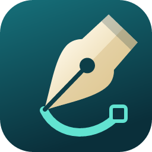
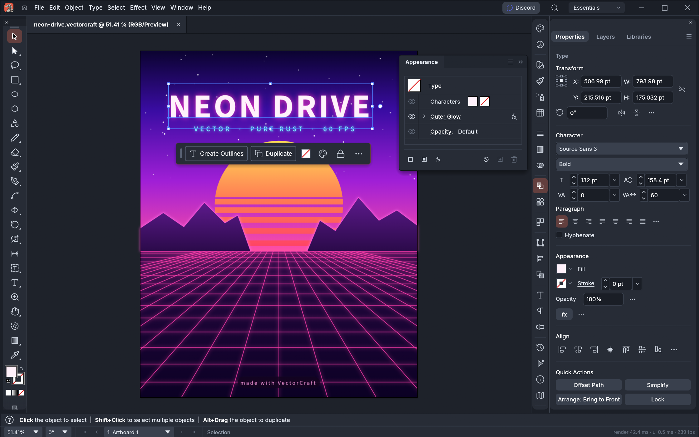
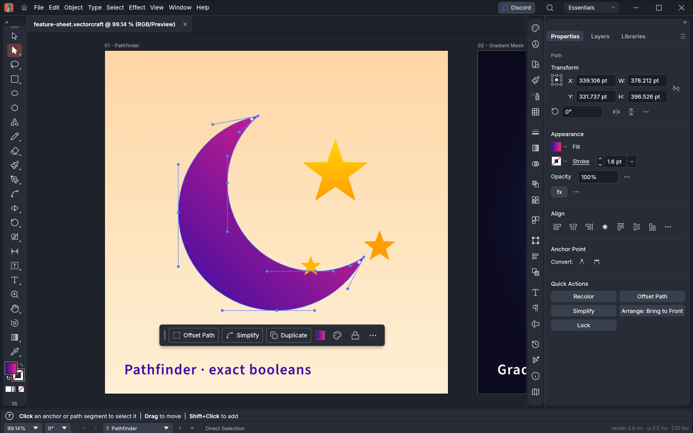
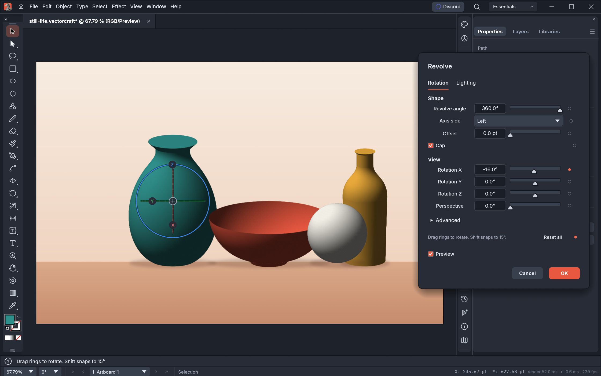
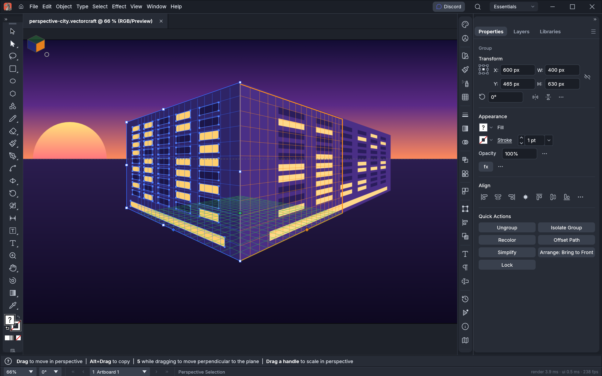
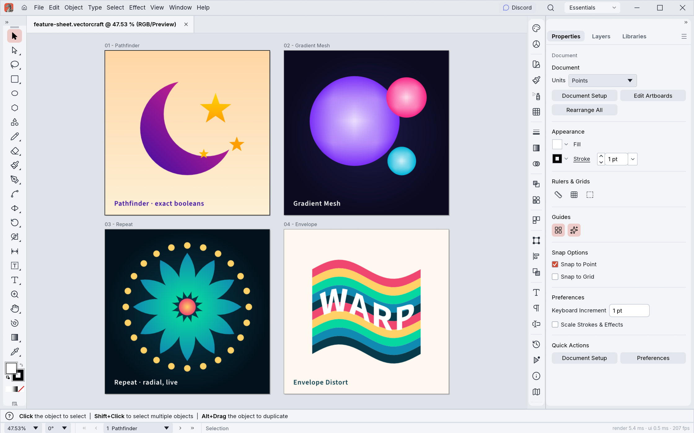

<p align="center">
  
</p>

<h1 align="center">Nib</h1>

<p align="center">
  <b>A free, open-source vector graphics editor for Windows, macOS and Linux.</b>
</p>

<p align="center">
  An Illustrator-class editor in pure Rust: Pen and shape tools, Pathfinder, live effects, type,
  artboards, symbols, SVG, PDF, EPS and PDF-compatible <code>.ai</code>, plus generative AI with
  your own OpenAI or Google Gemini key.
</p>

<p align="center">
  
  
  
  
</p>

<p align="center">
  <a href="https://github.com/Nihalpi1212/claude/releases"><b>Download</b></a> ·
  <a href="docs/USER-GUIDE.md">User guide</a> ·
  <a href="docs/PARITY.md">Nib vs Illustrator</a> ·
  <a href="https://github.com/Nihalpi1212/claude/issues">Report an issue</a>
</p>

> [!NOTE]
> **Nib is based on [VectorCraft](https://github.com/storytold/vectorcraft)**, the open-source vector
> editor by the ArtCraft team and the VectorCraft contributors (MIT OR Apache-2.0). Nib 0.1.0 is
> built on VectorCraft 0.24.1 (revision in [`UPSTREAM-REVISION`](UPSTREAM-REVISION)) and keeps
> almost all of its code. Nib is an independent project with its own name, icon, file extension
> (`.nibart`), releases and generative AI features. It opens VectorCraft's `.vectorcraft` files.
> [`docs/FORK.md`](docs/FORK.md) lists exactly what Nib changed.

<br>

<p align="center">
  
  <br><sub><b>Neon Drive</b>: a Pathfinder-cut sun, live Outer Glow on the type and grid, and clipping masks · <code>examples/neon-drive.vectorcraft</code><br>
  (Screenshot from VectorCraft; Nib's interface is the same apart from its name and icon.)</sub>
</p>

<p align="center">
  <a href="#what-nib-is">What Nib is</a> ·
  <a href="#what-nib-adds-generative-ai">What Nib adds</a> ·
  <a href="#downloads">Downloads</a> ·
  <a href="#first-launch-the-builds-are-not-code-signed">First launch</a> ·
  <a href="#building-from-source">Building</a> ·
  <a href="#status">Status</a> ·
  <a href="#what-nib-cannot-do">What Nib cannot do</a> ·
  <a href="#license-and-credits">License and credits</a>
</p>

## What Nib is

Nib is a desktop vector illustration app with the layout, tools, menus, panels and shortcuts that
people who know Adobe Illustrator expect. It is written from scratch in Rust (clean room: no Adobe
code, strings, assets or artwork) and runs natively on Windows, macOS and Linux.

What comes from VectorCraft, in short:

- **Drawing and editing:** Pen, Curvature, Pencil, shapes, Direct Selection with real Bézier
  anchors and handles, Smart Guides, snapping, Shape Builder, Live Paint, exact Pathfinder booleans.
- **Paint and appearance:** swatches, gradients (including freeform), patterns, Gradient Mesh,
  Recolor Artwork, brushes and width profiles, the Appearance panel, transparency, graphic styles,
  clipping and opacity masks.
- **Live effects:** vector effects, live Blends, Envelope Distort, Repeat, the Perspective Grid, an
  initial 3D Revolve, the Effect Gallery with Photoshop-style raster filters.
- **Type:** point, area and path type, character and paragraph styles, threading, bidirectional
  Hebrew and Arabic layout, initial vertical type.
- **Documents and files:** multiple artboards, layers, symbols, Image Trace, graphs, Export for
  Screens, print with separations, Package; SVG, PDF, PDF-compatible `.ai`, EPS, DXF, EMF/WMF, PSD and
  raster formats; Affinity documents open too.
- **Robustness:** unlimited undo, recovery after a crash, rendering on all cores off the
  interface thread.
- **Automation:** every menu item, tool gesture, panel and dialog can be driven over a JSON control
  channel and an MCP server, so scripts and agents can draw, edit and export the way a person does
  ([`docs/mcp.md`](docs/mcp.md), [`docs/control-protocol.md`](docs/control-protocol.md)).

The example artwork in [`examples/`](examples) was all built through that command API and renders in
Nib as is.

<table>
<tr>
<td width="50%" valign="top">
  
  <p align="center"><sub><b>Pen and Direct Selection</b>: real Bézier anchors and handles</sub></p>
</td>
<td width="50%" valign="top">
  
  <p align="center"><sub><b>3D Revolve</b> · <code>examples/still-life.vectorcraft</code></sub></p>
</td>
</tr>
<tr>
<td width="50%" valign="top">
  
  <p align="center"><sub><b>Perspective Grid</b> · <code>examples/perspective-city.vectorcraft</code></sub></p>
</td>
<td width="50%" valign="top">
  
  <p align="center"><sub><b>Artboards, light theme</b> · <code>examples/feature-sheet.vectorcraft</code></sub></p>
</td>
</tr>
</table>

## What Nib adds: generative AI

Nib adds six generative features that run with **your own API key** from OpenAI or Google Gemini.
Requests go straight from your computer to the provider you choose. There is no Nib server, account,
proxy or telemetry in between, and nothing is sent until you agree once in **Edit › AI Accounts…**.

| Feature | Where | What it does |
|---|---|---|
| **Text to Vector Graphic** | Object › Generative | Makes editable vector art from a prompt (as SVG, or as an image traced with Image Trace) |
| **Generative Shape Fill** | Object › Generative | Fills a selected closed shape with generated art, clipped to the shape |
| **Generative Pattern** | Object › Generative | Makes a seamless pattern swatch, optionally applied to the selection |
| **Generative Expand** | Object › Generative | Extends a placed image beyond its edges, keeping the original pixels |
| **Generative Recolor** | Edit › Edit Colors | Recolours the selected art from palettes the model proposes |
| **Rewrite Text** | Type | Rewrites the selected text (shorter, longer, more formal, more casual, fix spelling, or your own instruction), keeping its styles |

Each result is placed as one undo step. The provider bills your account for each request.
How to set it up and use it: [`docs/USER-GUIDE.md`](docs/USER-GUIDE.md). How it works, what is
sent and how keys are stored: [`docs/generative-ai.md`](docs/generative-ai.md).

## Downloads

Builds are on the [releases page](https://github.com/Nihalpi1212/claude/releases), under tags named
`nib-vX.Y.Z` (the repository holds other projects too; Nib's releases are the ones named "Nib").
`<ver>` below is the version number, for example `0.1.0`.

| Platform | Files |
|---|---|
| **Windows 10/11, x64** | `nib-<ver>-windows-x64.msi` (installer) · `nib-<ver>-windows-x64-portable.zip` (no install) |
| **macOS 11 or later, Apple silicon and Intel** | `nib-<ver>-macos-universal.dmg` (app) · `nib-cli-<ver>-macos-universal.zip` (command-line tool) |
| **Linux x86_64** (glibc 2.35 or later, e.g. Ubuntu 22.04+) | `nib-<ver>-linux-x86_64.AppImage` · `nib-<ver>-linux-x86_64.deb` · `nib-<ver>-linux-x86_64.tar.gz` |

`SHA256SUMS.txt` in each release lists the checksum of every file. Nib never updates itself and makes
no network request on its own: **Help › Check for Updates** opens the releases page in your browser.

Other builds (ARM64 Windows and Linux, Flatpak, RPM, FreeBSD, the web version) are not published by
Nib yet; the packaging scripts for them are in [`packaging/`](packaging) and can be run from source.

## First launch: the builds are not code-signed

Nib has no signing certificates, so your system will warn you the first time:

- **macOS:** the app is signed ad hoc and not notarized. Drag **Nib** to Applications, then
  right-click (or Control-click) it, choose **Open**, and **Open** again in the dialog. Or run once in
  Terminal: `xattr -dr com.apple.quarantine /Applications/Nib.app`
- **Windows:** SmartScreen may say "Windows protected your PC". Choose **More info**, then **Run
  anyway**.
- **Linux:** make the AppImage executable (`chmod +x nib-<ver>-linux-x86_64.AppImage`) and run it,
  or install the package with `sudo apt install ./nib-<ver>-linux-x86_64.deb`.

Check the download against `SHA256SUMS.txt` if you want to be sure it is the published file
(`sha256sum -c SHA256SUMS.txt --ignore-missing`).

## Building from source

You need Rust (stable; the workspace's minimum is in [`Cargo.toml`](Cargo.toml), `rust-version`), and
on Linux the usual X11/Wayland, GL and ALSA development packages (listed in
[`docs/development.md`](docs/development.md)).

```sh
git clone https://github.com/Nihalpi1212/claude
cd claude/nib

cargo run --release -p vectorcraft                                  # the app (binary: nib)
cargo run --release -p vectorcraft -- examples/dusk-poster.vectorcraft
cargo build --release -p vectorcraft-cli                            # the command-line tool (binary: nib-cli)

./target/release/nib-cli --version                                  # Nib 0.1.0 (based on VectorCraft 0.24.1)
./target/release/nib-cli convert examples/dusk-poster.vectorcraft dusk.png   # headless export
./target/release/nib-cli run --in examples/ribbons.vectorcraft --export out.pdf
./target/release/nib-cli mcp                                        # MCP server on stdio
```

The package names stay VectorCraft's (`vectorcraft`, `vectorcraft-cli`) so upstream changes merge
cleanly; the binaries they build are `nib` and `nib-cli`. Run `nib-cli --help` for every command.

- Tests: `cargo test -p <crate>` for the crates you change; CI runs the whole workspace
  ([`.github/workflows/nib-ci.yml`](../.github/workflows/nib-ci.yml)).
- Japanese interface and text fonts come from the optional
  [craft-fonts](https://github.com/storytold/craft-fonts) build input
  (`CRAFT_FONTS_DIR=/absolute/path/to/craft-fonts`); without it Japanese text uses the system's fonts.
- Packages: [`packaging/`](packaging) holds the scripts the release workflow runs
  ([`.github/workflows/nib-release.yml`](../.github/workflows/nib-release.yml)).
- Architecture and contributor notes: [`docs/architecture.md`](docs/architecture.md),
  [`docs/development.md`](docs/development.md). The engineering rules (clean room, no panics in shipped
  code, hostile input, asset licences) are in [`docs/upstream-agents.md`](docs/upstream-agents.md),
  VectorCraft's guide, which Nib follows for its code.

To use Nib from Claude Code or another MCP client:

```sh
claude mcp add nib -- /path/to/nib-cli mcp
```

## Status

**Nib 0.1.0 is an alpha.** It inherits VectorCraft's state at the imported revision: everyday vector
illustration is close to usable, but a professional can't switch from Illustrator yet. VectorCraft's
own self-assessment (2026-10-10, measured from its code against Adobe's public documentation) puts
feature breadth at about 88%, feature depth at about 75% and readiness for real work at about 62%.
The main gaps it lists:

- reliable exchange of real Illustrator `.ai` files (layer structure, live effects on save);
- an interaction-fidelity pass over every tool's modifiers and small behaviours;
- 3D and Materials beyond the initial Revolve;
- CJK composition for vertical type, scripting, parts of Variables;
- launch and stability on more real machines.

Nib's own additions are new and have only been tested in development, against a mock provider.

- [`docs/PARITY.md`](docs/PARITY.md): Nib vs Illustrator, and what cannot be built.
- [`ROADMAP.md`](ROADMAP.md): VectorCraft's roadmap at the imported revision, and Nib's roadmap.
- [`docs/target-app-parity.md`](docs/target-app-parity.md) and [`docs/gaps.md`](docs/gaps.md):
  VectorCraft's detailed parity tables and ranked gaps.
- [`docs/RELEASE-NOTES-0.1.0.md`](docs/RELEASE-NOTES-0.1.0.md): what is in 0.1.0 and its known
  issues.

## What Nib cannot do

Some Illustrator features are Adobe's online services, not parts of the app. Nib cannot offer them
and doesn't imitate them. What Nib offers instead:

| Adobe service | In Nib |
|---|---|
| **Creative Cloud Libraries** (synced libraries) | The **Libraries** panel keeps graphics, colours and text styles on your computer; export and import libraries as `.vclibrary` files, or keep them in any sync folder |
| **Adobe Fonts** sync | Fonts installed on your system, plus Nib's own Fonts folder (the Missing Fonts dialog's **Add Fonts**); **Type › Find Font** replaces missing fonts; **File › Package** collects a document's fonts |
| **Adobe Stock** | Place your own or openly licensed images and SVGs with **File › Place** |
| **Firefly** generative models | Nib's generative features with your own OpenAI or Gemini key ([above](#what-nib-adds-generative-ai)) |
| **Cloud documents** | Ordinary files (`.nibart`, `.ai`, PDF, SVG) you can keep in any folder, including a synced one |
| **Share for Review** | Export a PDF, SVG or PNG and share it with whatever tool you already use |

More in [`docs/PARITY.md`](docs/PARITY.md#cannot-be-built-faithfully).

## License and credits

Nib is dual-licensed under [MIT](LICENSE-MIT) or [Apache-2.0](LICENSE-APACHE), at your option.
Copyright (c) 2026 the Nib contributors.

**Credits.** Nib is based on [VectorCraft](https://github.com/storytold/vectorcraft), copyright (c)
2026 the ArtCraft team and the VectorCraft contributors, under the same licences. Nearly everything
in this editor is their work; the upstream contributors are credited in **Help › About ›
Contributors** and in [`contributors/`](contributors). Required notices are in [NOTICE](NOTICE).

Bundled fonts, icons, images and other assets keep their own open licences; each is listed with its
author, source and licence in [ASSETS.md](ASSETS.md) (and [ATTRIBUTION.md](ATTRIBUTION.md)). Builds
made with [craft-fonts](https://github.com/storytold/craft-fonts) also embed its fonts (SIL Open Font
License 1.1).

The app icon ([`assets/app-icon/nib.svg`](assets/app-icon/nib.svg): a fountain-pen nib drawing a
curve on a deep-teal tile) is original artwork by the Nib contributors; see
[`assets/app-icon/README.md`](assets/app-icon/README.md). Nib uses none of the ArtCraft or
VectorCraft names, wordmarks or logos as its own, and is not affiliated with or endorsed by Adobe.
Illustrator, Creative Cloud, Adobe Fonts, Adobe Stock and Firefly are trademarks of Adobe.
