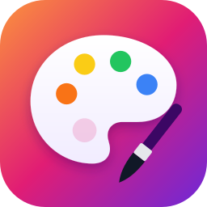
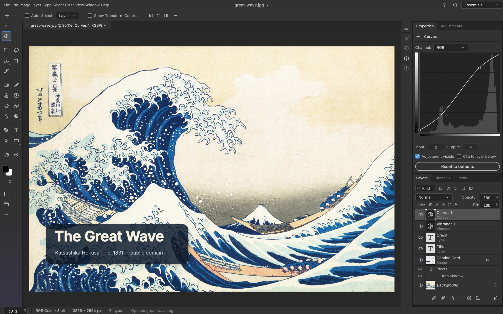

<p align="center">
  
</p>

<h1 align="center">Pigment</h1>

<p align="center">
  <b>A free, open-source image editor for Windows, macOS and Linux.</b>
</p>

<p align="center">
  A Photoshop-class editor in pure Rust: layers, masks, adjustment layers, layer styles, type,
  vectors, brushes and real PSD files, in a native app that works offline and makes no network
  request on its own.
</p>

<p align="center">
  
  
  
  
</p>

<p align="center">
  <a href="https://github.com/Nihalpi1212/claude/releases"><b>Download</b></a> ·
  <a href="docs/user/">User guide</a> ·
  <a href="docs/FORK.md">What Pigment changed</a> ·
  <a href="https://github.com/Nihalpi1212/claude/issues">Report an issue</a>
</p>

> [!NOTE]
> **Pigment is based on [PhotoCraft](https://github.com/storytold/photocraft)**, the open-source,
> clean-room Photoshop reimplementation by the ArtCraft team and the PhotoCraft contributors
> (MIT OR Apache-2.0). Pigment 0.5.0 is built on PhotoCraft 0.23.1 (revision in
> [`UPSTREAM-REVISION`](UPSTREAM-REVISION)) and keeps almost all of its code. Pigment is an
> independent project with its own name, icon, file extension (`.pigment`), settings folder and
> releases. It opens PhotoCraft's `.pcraft` files. [`docs/FORK.md`](docs/FORK.md) lists exactly what
> Pigment changed.

<br>

<p align="center">
  
  <br><sub>A caption card with a drop shadow, live type, and Vibrance and Curves adjustment layers, with the Curves editor open.<br>
  <i>The Great Wave off Kanagawa</i>, Katsushika Hokusai, c. 1831.<br>
  (Screenshot from PhotoCraft; Pigment's interface is the same apart from its name and icon.)</sub>
</p>

<p align="center">
  <a href="#what-pigment-is">What Pigment is</a> ·
  <a href="#everything-in-the-box">Everything in the box</a> ·
  <a href="#generative-ai">Generative AI</a> ·
  <a href="#pigment-04-and-earlier">Pigment 0.4 and earlier</a> ·
  <a href="#downloads">Downloads</a> ·
  <a href="#first-launch-the-builds-are-not-code-signed">First launch</a> ·
  <a href="#building-from-source">Building</a> ·
  <a href="#status">Status</a> ·
  <a href="#license-and-credits">License and credits</a>
</p>

## What Pigment is

Pigment is a desktop image editor with the layout, tools, menus, panels and shortcuts that people
who know Adobe Photoshop expect. It is written in Rust (clean room: no Adobe code, strings, assets or
artwork), draws its interface with egui on a wgpu GPU compositor (Metal, Vulkan, DX12), and runs
natively on Windows, macOS and Linux.

What comes from PhotoCraft, in short:

- **Layers and masks:** pixel, group, type, shape, fill, adjustment and smart object layers, layer
  and vector masks, clipping masks, blend modes and Blend If, layer comps, artboards.
- **Non-destructive editing:** 16 adjustment layers (Curves, Levels, Vibrance, Hue/Saturation,
  Black & White, Channel Mixer, Gradient Map, Photo Filter, …), smart filters, layer styles (Drop
  Shadow, Glows, Bevel & Emboss, Satin, Stroke, overlays) on any layer, type included.
- **Selections:** marquees, lassos, Magic Wand, Quick Selection, Object Selection, Select Subject
  and Select and Mask, all on your machine.
- **Painting and retouching:** brushes with Photoshop's dynamics and `.abr` import, Mixer Brush,
  Clone Stamp, Healing, Patch, Remove, Content-Aware Fill, History Brush, gradients and patterns.
- **Type and vectors:** point and paragraph type edited on the canvas, Character and Paragraph
  panels; shape layers, the Pen tools, path operations and the Paths panel.
- **Filters:** blurs (including the Blur Gallery), sharpening, distortions, Liquify, Camera Raw,
  noise, render filters, with live previews through the selection.
- **Files:** layered PSD and PSB read and written, TIFF, PNG, JPEG, WebP, GIF, BMP, OpenEXR, HDR,
  camera raw, PDF, SVG, OpenRaster, Krita, GIMP XCF, Paint.NET and Affinity documents (most of them
  read-only), 8, 16 and 32-bit RGB, grayscale, CMYK, Lab, indexed, duotone and multichannel.
- **Robustness:** unlimited undo, crash recovery, copy-on-write tiles, multithreaded filters.
- **Automation:** every menu item, tool, panel and dialog is a command you can drive from
  `pigment-cli`, a JSON control channel or an MCP server ([`docs/mcp.md`](docs/mcp.md),
  [`docs/control-protocol.md`](docs/control-protocol.md)).

What Pigment adds: **generative AI** with your own OpenAI or Google Gemini account (Generative Fill
and Expand, Generate Image, Remove and Generate Background, Sky Replacement, Describe Image and an
Assistant that edits the document). It is optional, and nothing is sent until you set it up and
run one of these features; see [Generative AI](#generative-ai) below.

PhotoCraft's own feature tour, with screenshots, is in its documentation under [`docs/`](docs) and
[`book/`](book); read "PhotoCraft" there as "Pigment".

## Everything in the box

<table>
  <tr>
    <td width="33%" valign="top">
      <h4>🧰 69 tools</h4>
      Move · Artboard · Rectangular and Elliptical Marquee · Single Row Marquee · Single Column Marquee · Lasso · Polygonal Lasso · Magnetic Lasso · Object Selection · Quick Selection · Magic Wand · Crop · Perspective Crop · Slice · Slice Select · Frame · Eyedropper · Color Sampler · Ruler · Note · Count · Remove · Spot Healing Brush · Healing Brush · Patch · Content-Aware Move · Red Eye · Brush · Pencil · Mixer Brush · Color Replacement · Clone Stamp · Pattern Stamp · History Brush · Art History Brush · Eraser · Background Eraser · Magic Eraser · Gradient · Paint Bucket · Blur · Sharpen · Smudge · Dodge · Burn · Sponge · Pen · Freeform Pen · Curvature Pen · Add Anchor Point · Delete Anchor Point · Convert Point · Horizontal and Vertical Type · Horizontal and Vertical Type Mask · Path Selection · Direct Selection · Rectangle · Ellipse · Triangle · Polygon · Star · Line · Custom Shape · Hand · Rotate View · Zoom
    </td>
    <td width="33%" valign="top">
      <h4>🖌️ A real brush engine</h4>
      Shape Dynamics, Scattering, Texture, Dual Brush, Color Dynamics, Transfer, Brush Pose, Wet Edges, Build-up and Smoothing (including Pulled String), driven by pen pressure, tilt, rotation and direction. Brush presets, Define Brush from Selection, and deterministic, replayable strokes.
    </td>
    <td width="33%" valign="top">
      <h4>🗃️ Layers, done properly</h4>
      Groups, clipping masks, pixel and vector masks, fill layers (solid, gradient and pattern), adjustment layers, live smart objects with smart filters and lossless transforms and warps, multi-layer selection with align, distribute and link, alpha channels and Quick Mask, 27 Photoshop blend modes plus six Paint.NET variants, opacity and fill, locks, colour labels, a layer kind filter, merge, flatten, rasterize, Layer via Copy/Cut, Paste Into.
    </td>
  </tr>
  <tr>
    <td width="33%" valign="top">
      <h4>🎨 Any colour, any depth</h4>
      RGB, Grayscale, CMYK and Lab documents at 8, 16 and 32 bits per channel. Bit depth and colour model are runtime data, so every tool works at every depth.
      <br><br>
      Real ICC colour management in pure Rust: embedded profiles, Assign and Convert to Profile with all four rendering intents and black point compensation, soft proofing (⌘Y) and Gamut Warning (⇧⌘Y) on the GPU.
    </td>
    <td width="33%" valign="top">
      <h4>🗂️ Formats</h4>
      PSD and PSB, layered TIFF (Photoshop's layer data in the TIFF, read and written in either byte order), <a href="docs/pdn.md">Paint.NET PDN3 (read, with editable layers and all 14 blend modes)</a>, <a href="docs/ora.md">OpenRaster (read and write, with layers, groups and blend modes, for Krita, MyPaint and GIMP)</a>, <a href="docs/xcf.md">GIMP XCF (read, with layers, groups, masks, blend modes, channels and the selection)</a>, <a href="docs/kra.md">Krita .kra (read, with paint layers, groups, blend modes and transparency masks)</a>, SVG (opens as shape layers, places as a vector Smart Object), plus flat PNG, JPEG, TIFF, WebP (lossy and lossless), GIF, BMP, TGA, ICO, QOI, PNM, OpenEXR, Radiance HDR and FITS (astronomy images: 8/16-bit and 32-bit float, gray or RGB, header kept), and the native <code>.pcraft</code> format. Flat formats retain the depths they support: PNG keeps 8/16-bit samples, TIFF keeps 8/16-bit and 32-bit float samples, and OpenEXR keeps half/float samples; JPEG, WebP and the other 8-bit formats reduce higher-depth samples with an export warning. See the <a href="https://github.com/storytold/craft-libs/tree/main/crates/image-codecs#capability-matrix-default-build">codec capability matrix</a> for each format. HEIC photos from iPhone and Mac are read-only (included in official builds; optional <code>--features heif</code> for source builds). AVIF is write-only with the optional <code>avif</code> build feature; AVIF decoding and JPEG XL are unavailable. Affinity documents (<code>.af</code>, <code>.afdesign</code>, <code>.afphoto</code>, <code>.afpub</code>) open natively, read only, with artboards, layers, vectors, text, images and masks; effects, adjustments and other unsupported parts are listed in a warning, and Affinity export is unavailable.
    </td>
    <td width="33%" valign="top">
      <h4>🪄 The everyday essentials</h4>
      Auto Tone, Contrast and Color · Equalize · Image and Canvas Size · Crop and Trim · Reveal All · Edit › Fill and Stroke · Copy Merged · Paste in Place · guides, rulers, grid and snapping · Actions record and replay · a command palette (⌘F).
    </td>
  </tr>
</table>

## Generative AI

Pigment 0.5 has the generative AI of Pigment 0.4, rebuilt for the new app. It is optional and uses
**your own account** with OpenAI or Google Gemini; without one, Pigment works as before and sends
nothing.

| Feature | Where to find it | What it does |
|---|---|---|
| **Generative Fill** | Edit › Generative Fill…, the bar under a selection, or right-click a selection | Fills the selection with what you describe, using the image around it. 1 to 3 variations, each on a new layer. |
| **Generative Expand** | The Crop tool's bar (drag the crop frame past the canvas), or the command palette | Enlarges the canvas and fills the new area so the picture continues. |
| **Generate Image** | Edit › Generate Image… | Makes a picture from a description, as a new layer or a new document, with a transparent background if you like. |
| **Remove Background** | Layer › Remove Background | Masks the layer down to its subject **on your computer**: no account, nothing sent. |
| **Remove Background with AI Provider** | Layer › Remove Background with AI Provider | The same, with the subject found by the provider's image model. |
| **Generate Background** | Layer › Generate Background…, or the bar that appears after Remove Background | Keeps the subject and generates new surroundings from a description, on a new layer. |
| **Sky Replacement** | Edit › Sky Replacement… | Generates a new sky from a description. The sky is your selection, or the one Select › Sky finds. |
| **Describe Image** | Image › Describe Image… | Describes the picture in words, to copy or to keep as the document's description (File Info). |
| **Assistant** | Window › Assistant | A chat about the open document that can also edit it for you: adjustments, filters, layers, selections, text, Generative Fill. Every step it takes is an ordinary undo step. |
| **AI Accounts** | Edit › AI Accounts…, or Preferences › AI Integrations | Your keys, the models, the agreement, and whether AI agents may use these features. |

Every one of them is also in the command palette (⌘F / Ctrl+F). There is no AI menu: the features
sit where Photoshop puts them. The buttons in the bars (under a selection, in the Crop tool's bar,
after Remove Background) appear once an account with an image model is connected, so the bars
stay as they were for people who don't use AI.

**Setting it up.** Open **Edit › AI Accounts…**, paste an API key from
[OpenAI](https://platform.openai.com/api-keys) or
[Google AI Studio](https://aistudio.google.com/apikey) and press **Connect**. Pigment checks the
key with the provider and then keeps it in the macOS Keychain or the Windows Credential Manager; on
Linux it is kept in `ai-keys.json` in Pigment's settings folder, readable only by you (not
encrypted). Then tick the agreement in the same dialog, once.

- **Nothing is sent before that agreement** (Connect only asks the provider for its list of
  models, to check your key), and afterwards only when you run a feature: your prompt and, where
  the feature needs it, the image, the layer or the selection. Never your files, and your key
  only to its own provider. The windows say what each feature sends.
- **The provider bills your account for every request**, including one you stop after it was sent.
- **Your pixels are safe.** A generated result lands on a new layer (or as a layer mask) in one
  undo step; the pixels outside the selection or mask are never changed.
- **Sign in with ChatGPT (experimental).** The OpenAI tab can use a ChatGPT Plus or Pro plan
  instead of an API key, for the Assistant and Describe Image only; the image features always need
  an API key. This sign-in uses a route OpenAI has not documented as a stable service, and it
  could not be tried against the real one, so it may not work or may stop working.
- **Actions, batches and droplets never call a provider**, so replaying an action never spends
  money. AI agents (MCP, the control channel) and `pigment-cli run` may use these features only
  after you allow it: **Allow agents to run AI commands** in AI Accounts, or `--allow-ai` on the
  command line.
- **From the command line:** `pigment-cli ai status`, `ai set-key`, `ai consent`, `ai test`,
  `ai sign-in` and the rest do what AI Accounts does (`pigment-cli ai --help`).

No live account was available while this was built: every feature was tested against local
stand-ins for the two providers. If a real account behaves differently, please
[report it](https://github.com/Nihalpi1212/claude/issues).
[`docs/generative-ai.md`](docs/generative-ai.md) has the details: what each feature sends, how keys
are kept, the Assistant's tools and limits, and a feature-by-feature comparison with Pigment 0.4.

## Pigment 0.4 and earlier

Pigment 0.1 to 0.4 were a different program, an Electron app written in JavaScript, released up to
[`pigment-v0.4.0`](https://github.com/Nihalpi1212/claude/releases/tag/pigment-v0.4.0). Pigment 0.5 is
Pigment on PhotoCraft and replaces it: PhotoCraft already does far more of what Photoshop does.

- The two apps have different application ids and keep their settings apart; Pigment 0.5 reads
  nothing of the old app's.
- **The generative AI is back, and you connect it again.** API keys and the ChatGPT sign-in of
  Pigment 0.4 are not carried over (they were sealed by the old app): enter them once more in
  Edit › AI Accounts…. What works differently from 0.4 is listed in
  [`docs/RELEASE-NOTES-0.5.0.md`](docs/RELEASE-NOTES-0.5.0.md).
- **Before you install 0.5 over 0.4, export your old documents.** On Windows and macOS Pigment 0.5
  installs where 0.4 was (`%LOCALAPPDATA%\Programs\Pigment` or `C:\Program Files\Pigment`, and
  `Pigment.app` in Applications) and replaces it. To keep 0.4, pick another folder on the
  installer's folder page (Windows) or copy `Pigment.app` somewhere else first (macOS). On Linux
  the AppImages sit side by side.
- **Your old `.pigment` documents open.** Pigment 0.5 saves `.pigment` files in PhotoCraft's native
  format and recognises a file saved by Pigment 0.1 to 0.4 by its content. What it converts so far:
  the document (size, resolution, image mode, 8, 16 and 32 bits per channel), pixel, group,
  adjustment, fill and shape layers with their opacity, blend mode, locks, clipping, masks, vector
  masks, layer styles and advanced blending (Blend If, knockout, channels), colour labels and links,
  the selection, saved channels, guides, paths and File Info. A few adjustments Pigment 0.4 added
  (Color and Vibrance, Clarity and Dehaze, Grain) keep their settings but change nothing yet, and
  some adjustments and effects look slightly different, because PhotoCraft computes them as
  Photoshop does. **Not converted yet:** text layers, smart objects and their filters. Such a layer
  opens empty in its place, and the notes shown after opening list each one. File › Save asks for
  a new file name, so the old file stays as it was; keep it until the rest is converted. A file
  that cannot be read says "This Pigment 0.4 file is damaged:" and why.

## Downloads

Builds are on the [releases page](https://github.com/Nihalpi1212/claude/releases), under tags named
`pigment-vX.Y.Z` (the repository holds other projects too; Pigment's releases are the ones named
"Pigment"). `<ver>` below is the version number, for example `0.5.0`.

| Platform | Files |
|---|---|
| **Windows 10/11, x64** | `pigment-<ver>-windows-x64.msi` (installer) · `pigment-<ver>-windows-x64-portable.zip` (no install) |
| **macOS 11 or later, Apple silicon and Intel** | `pigment-<ver>-macos-universal.dmg` (app) · `pigment-cli-<ver>-macos-universal.zip` (command-line tool) |
| **Linux x86_64** (glibc 2.35 or later, e.g. Ubuntu 22.04+) | `pigment-<ver>-linux-x86_64.AppImage` · `pigment-<ver>-linux-x86_64.deb` · `pigment-<ver>-linux-x86_64.tar.gz` |

`SHA256SUMS.txt` in each release lists the checksum of every file. Pigment never updates itself and
makes no network request on its own: **Help › Check for Updates** opens the releases page in your
browser.

The Windows portable zip keeps everything in a `PigmentData` folder beside `pigment.exe` (the
`portable.txt` file switches it on). The Linux AppImage needs no install; run it with `--cli` to
reach `pigment-cli` (`--cli mcp` starts the MCP server). Other builds (ARM64 Windows and Linux,
Flatpak, RPM, FreeBSD, the web version) are not published yet; the packaging scripts for them are in
[`packaging/`](packaging) and can be run from source.

## First launch: the builds are not code-signed

Pigment has no signing certificates, so your system will warn you the first time:

- **macOS:** the app is signed ad hoc and not notarized. Drag **Pigment** to Applications, then
  right-click (or Control-click) it, choose **Open**, and **Open** again in the dialog. Or run once in
  Terminal: `xattr -dr com.apple.quarantine /Applications/Pigment.app`
- **Windows:** SmartScreen may say "Windows protected your PC". Choose **More info**, then **Run
  anyway**.
- **Linux:** make the AppImage executable (`chmod +x pigment-<ver>-linux-x86_64.AppImage`) and run
  it, or install the package with `sudo apt install ./pigment-<ver>-linux-x86_64.deb`.

Check the download against `SHA256SUMS.txt` if you want to be sure it is the published file
(`sha256sum -c SHA256SUMS.txt --ignore-missing`).

## Building from source

You need Rust (stable; the workspace's minimum is `rust-version` in [`Cargo.toml`](Cargo.toml)), and
on Linux the usual X11/Wayland, GL and GTK development packages (listed in
[`docs/development.md`](docs/development.md)).

```sh
git clone https://github.com/Nihalpi1212/claude
cd claude/pigment

cargo run --release -p photocraft                          # the app (binary: pigment)
cargo run --release -p photocraft -- image.psd
cargo build --release -p photocraft-cli                    # the command-line tool (binary: pigment-cli)

./target/release/pigment-cli --version                     # Pigment 0.5.0 (based on PhotoCraft 0.23.1)
./target/release/pigment-cli convert image.psd image.png   # headless export
./target/release/pigment-cli convert image.psd image.pigment
./target/release/pigment-cli mcp                           # MCP server on stdio
```

The package names stay PhotoCraft's (`photocraft`, `photocraft-cli`) so upstream changes merge
cleanly; the binaries they build are `pigment` and `pigment-cli`. Run `pigment-cli --help` for every
command.

- Tests: `cargo test -p <crate>` for the crates you change; CI runs the whole workspace
  ([`.github/workflows/pigment-ci.yml`](../.github/workflows/pigment-ci.yml)).
- Translations come from [craft-i18n](https://github.com/storytold/craft-i18n) at the commit in
  [`craft-i18n.rev`](craft-i18n.rev): check it out and set `CRAFT_I18N_DIR=/absolute/path/to/craft-i18n`
  (without it the interface is English only). Japanese interface and text fonts come from the
  optional [craft-fonts](https://github.com/storytold/craft-fonts) input (`CRAFT_FONTS_DIR`).
- Packages: [`packaging/`](packaging) holds the scripts the release workflow runs
  ([`.github/workflows/pigment-release.yml`](../.github/workflows/pigment-release.yml)).
- Architecture and contributor notes: [`AGENTS.md`](AGENTS.md) (PhotoCraft's guide, whose
  engineering rules Pigment follows) and [`docs/`](docs).

To use Pigment from Claude Code or another MCP client:

```sh
claude mcp add pigment -- /path/to/pigment-cli mcp
```

By default that is a session without a window. To let AI apps work in the open window, turn on
**Preferences › AI Integrations › Let AI apps use this window**. An AI app can run the generative
features, which are billed to your account, only while **Allow agents to run AI commands** is on
in Edit › AI Accounts….

## Status

**Pigment 0.5.0 is an alpha.** It inherits PhotoCraft's state at the imported revision: everyday
photo editing and PSD work are close to usable, but a professional can't switch from Photoshop yet.
PhotoCraft's own [`ROADMAP.md`](ROADMAP.md) and [`docs/`](docs) list what is missing.
[`docs/RELEASE-NOTES-0.5.0.md`](docs/RELEASE-NOTES-0.5.0.md) says what is in 0.5.0 and its known
issues. The generative AI of Pigment 0.4 is in 0.5.0 (see [Generative AI](#generative-ai)); its
other additions are not yet.

## License and credits

Pigment is dual-licensed under [MIT](LICENSE-MIT) or [Apache-2.0](LICENSE-APACHE), at your option.
Copyright (c) 2026 the Pigment contributors.

**Credits.** Pigment is based on [PhotoCraft](https://github.com/storytold/photocraft), copyright (c)
2026 the ArtCraft team and the PhotoCraft contributors, under the same licences. Nearly everything in
this editor is their work; the upstream contributors are credited in **Help › About › Contributors**
and in [`contributors/`](contributors). Required notices are in [NOTICE](NOTICE).

Bundled fonts, icons, images and other assets keep their own open licences; each is listed with its
author, source and licence in [ATTRIBUTION.md](ATTRIBUTION.md). Builds made with
[craft-fonts](https://github.com/storytold/craft-fonts) also embed its fonts (SIL Open Font License
1.1). Every artwork in the screenshots is in the public domain; sources are in
[`docs/images/SOURCES.md`](docs/images/SOURCES.md).

The app icon ([`assets/app-icon/pigment.svg`](assets/app-icon/pigment.svg): a paint palette and brush
on an orange-to-violet tile) is Pigment's own; see
[`assets/app-icon/README.md`](assets/app-icon/README.md). Pigment uses none of the ArtCraft or
PhotoCraft names, wordmarks or logos as its own, and is not affiliated with or endorsed by the
ArtCraft team or Adobe.

<sub>Adobe and Photoshop are trademarks or registered trademarks of Adobe Inc. in the United States
and/or other countries. Pigment is an independent, open-source project and is not affiliated with,
sponsored by or endorsed by Adobe Inc.; these names are used only to describe the workflows it is
compatible with.</sub>
